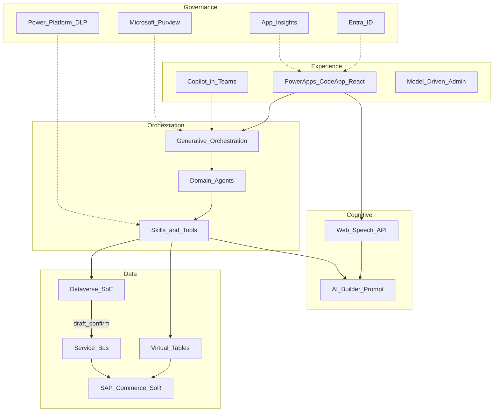

# 02 · 系统架构

架构由五个职责清晰的功能区组成：**体验层 → 认知层 ∥ 编排层 → 数据层**，**治理层**横切全栈。不是简单堆叠，而是「前端体验 → 认知/编排双引擎 → 共生数据」的纵深结构。

## 总览图

## 体验层

### Power Apps Code App（主战场）

- 以 **React** 编写真正的移动 UI（手势、相机、语音、离线缓存）
- 同时享受 Power Platform 的身份、连接器与治理
- 本仓库即此层的主体验：**SalesCompanion**

### 两侧入口

| 入口 | 用途 |
| --- | --- |
| **Copilot in Teams** | 会议中临时查询 |
| **Model Driven App** | 管理后台快速生成（运营、配置、审计视图） |

移动端产品原则：只有「对话 · 看板 · 任务」三入口；新增能力靠注册 Agent，而非重构导航。

## 认知层

**语音走设备，文本走 AI Builder。**

| 能力 | 说明 |
| --- | --- |
| Web Speech API / 设备输入法 | 本地多语种转写；无额外语音订阅 |
| AI Builder Prompt (GPT) | 字段抽取、摘要、分类、草稿生成 |
| Form Processing / Entity Extraction | 表单与实体结构化 |
| Azure AI Search | Phase 3 售后知识库语义检索 |

前端与编排层共用 AI Builder 能力。

## 编排层

Agent 不是聊天机器人，而是有目标、可调用工具的执行单元。

| 组件 | 职责 |
| --- | --- |
| **Copilot Studio Agents** | 注册知识与工具集 |
| **Generative Orchestration** | 按意图分发任务、合成回复 |
| **Agent Flow** | 事务性长流程（顺序依赖、回滚） |
| **MCP / Custom Connectors** | 对接 SAP 与外部系统 |

详细三层模型与协同模式见 [03 Agent 架构](03-agent-architecture.md)。

## 数据层：SAP 共生，不替换底座

### 选型结论：Virtual Tables + 事件驱动回写

| 方案 | 做法 | 结论 |
| --- | --- | --- |
| A 整迁 / 双写 | 全量同步到 Dataverse | **不采用**：同步重、冲突多、审计复杂 |
| B 纯实时 API/MCP | 零复制，每次直调 SAP | **不作为主路径**：跨境延迟、复杂查询难编排 |
| **C VT + 异步回写** | 读靠 VT，写靠草稿→确认→Service Bus | **采用** |

### 读写路径

| 方向 | 路径 |
| --- | --- |
| **读** | Virtual Tables 直连 SAP 关键实体；高频字段可近实时缓存 |
| **写** | Dataverse 草稿 → 用户 Confirm → Azure Service Bus → SAP |
| **AI 元数据** | 摘要、置信度、调用日志原生落在 Dataverse |
| **大文件** | 拜访照片 / 设备铭牌 → Azure Blob Storage |

接入统一经 **Azure API Management**；权威记录仍在 **SAP Commerce CRM**（合同、价格、订单履约等）。

详见 [06 数据模型](06-data-model.md)、[07 SAP 集成](07-integration-sap.md)。

## 治理层（横切）

| 能力 | 产品 |
| --- | --- |
| SSO / 角色 | Microsoft Entra ID（沿用现有 SAP 角色映射） |
| 连接器边界 | Power Platform DLP |
| 环境与发布 | Managed Environments + Pipelines |
| AI 输出守护 | Copilot Studio 内容审核与 PII 屏蔽 |
| 审计 | Microsoft Purview |
| 凭据 | Azure Key Vault |
| 可观测 | Azure Application Insights（拜访完成率、Agent 成功率、SAP 写入时延） |

## 与本仓库映射

| 架构层 | 本仓库 / 平台落点 |
| --- | --- |
| 体验 | `src/` React Code App；[`power.config.json`](../power.config.json) |
| 认知 | 浏览器 Web Speech + AI Builder（连接器 / 自定义 API） |
| 编排 | Copilot Studio（仓外配置）+ 前端统一对话入口 |
| 数据 | Dataverse 表 / VT（`databaseReferences`）+ Custom Connector |
| 治理 | 环境拓扑与 DLP（平台侧）；App Insights SDK（前端可选） |

## 相关文档

- [01 产品总览](01-product-overview.md)
- [03 Agent 架构](03-agent-architecture.md)
- [08 ALM 交付](08-alm-delivery.md)
