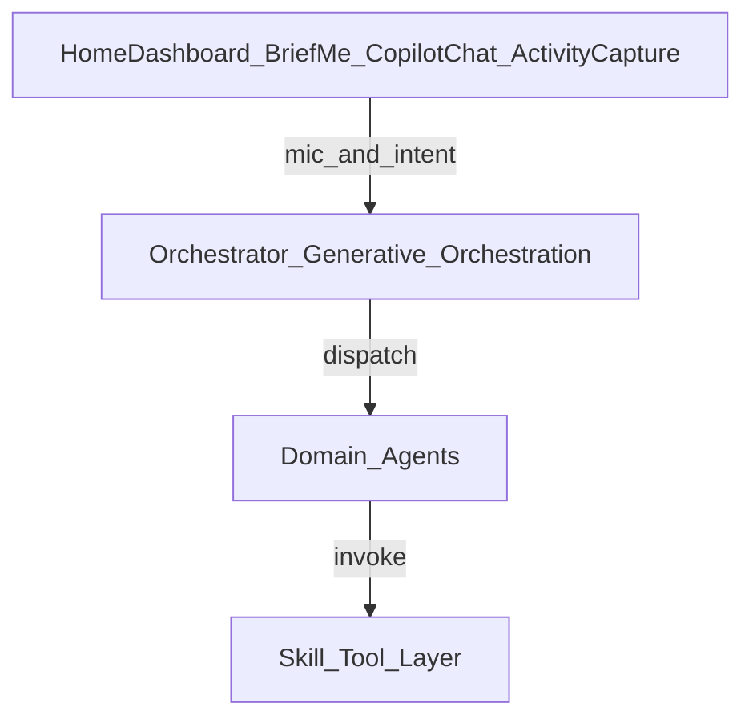
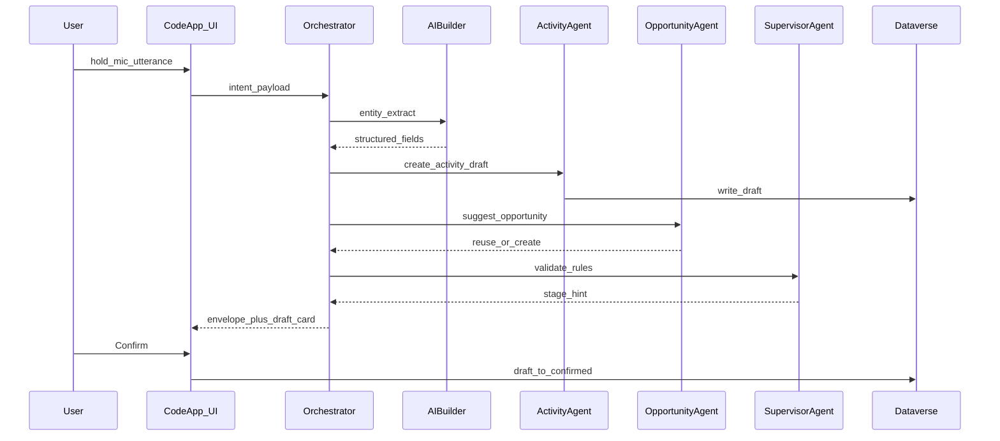

# 03 · Agent 架构

> 提案锚点：[Agent 多 Agent 协同](https://illusion615.github.io/KnowledgeHub/posts/mindray-crm-ai-proposal/index.html#agent-architecture)

Agent 全景回答「有哪些 Agent」；本节回答「它们怎么协同」。采用 Copilot Studio **Generative Orchestration** 作为调度核心：三层职责、四种协作模式、一条统一消息契约——新 Agent 加入时无需修改现有 Agent。

## 三层职责



**设计原则：** 上层只调下层，跨层不可越级；新 Agent 只需在 Tier 2 注册并声明所需 Tier 3 工具，Orchestrator 通过描述自动学会调度。

### Tier 1 · Orchestrator Agent（全局唯一）

由 Generative Orchestration 充当。**不执行业务逻辑**，只做三件事：

1. 理解用户意图  
2. 选择业务 Agent  
3. 把多 Agent 回答合成一段连贯回复  

所有界面（HomeDashboard / BriefMe / CopilotChat / ActivityCapture）的麦克风最终都打到这一个 Orchestrator。

### Tier 2 · Domain Agents

与业务概念一一对应（见 [04 Agent 全景目录](04-agent-catalog.md)）。每个 Agent 拥有：

- 自己的 system prompt  
- 知识源（Dataverse / SAP 虚拟表 / 知识库）  
- 可调用工具集  

**Domain Agent 之间默认不直接互调**，统一由 Orchestrator 串联，避免硬编码依赖。

### Tier 3 · Skill / Tool Layer

原子能力、单一职责，可被多个 Domain Agent 复用：

| 工具 | 用途 |
| --- | --- |
| SAP Commerce Connector | 读写 SoR（经 APIM） |
| Dataverse CRUD | SoE 草稿与元数据 |
| AI Builder Prompt (GPT) | 抽取、摘要、草稿 |
| Form Processing | OCR / 表单结构化 |
| Azure AI Search | Phase 3 知识检索 |
| Power Automate / Agent Flow | 长事务与回写 |

治理与权限由 Power Platform 集中管控。

## 四种协作模式

### 1. 并行扇出 · Fan-out

同一意图明显涉及多个独立信息源时，Orchestrator 同时调用多个 Domain Agent；延迟 ≈ `max(各 Agent)`，按 `agent_chain` 顺序渲染。

**示例：**「Hospital Beta 最新进度？」→ 客户画像 + 商机评估 + 订单查询 并行。

### 2. 顺序流水 · Sequential

后序依赖前序输出时，在 Agent Flow 内串行；任一步失败 → 全流程回滚到 draft。

**示例：** 拜访录音 → 实体抽取 → 活动创建 → 商机创建（带 confidence 拦截）。

### 3. 条件路由 · Routing

意图模糊或参数不全时，先轻量分类再分发；置信度低于阈值 → **反问**而非猜测。

**示例：**「这单怎么样了」→ 判「订单查询」还是「商机评估」→ 只调一方。

### 4. 审阅闭环 · Review-Loop

涉及写操作时，执行 Agent 先生成 **draft**；独立审阅/督导 Agent 校验规则与重复；用户 UI 一键 Confirm / Discard 才真正提交。

**示例：** 商机创建 → 商机督导（重复检测 / 阶段合理性）→ 用户 Confirm。

## 统一消息契约

业务方新增 Agent 时只需遵守下列三条契约，即可被 Orchestrator 识别并被任何前端复用。

### ① Message Envelope

所有 Agent 输入输出统一为：

```ts
type AgentMessage = {
  role: 'user' | 'assistant' | 'system' | 'tool'
  agent_name: string
  content: string
  sources: SourceRef[]
  confidence: number // 0..1
  draft?: DraftPayload
}

type SourceRef = {
  kind: 'dataverse' | 'sap' | 'knowledge' | 'other'
  label: string
  ref?: string
}
```

UI 按此结构渲染气泡与来源 chip，**不感知 Agent 内部实现**。

### ② Source Citation

任何回答必须附带 `sources[]`；CopilotChat「来源」行直接渲染，让销售一眼判断可信度。

### ③ Shared Memory

一次会话的中间结果（`accountId` / `opportunityId` / 当前 BriefItem）写入 `CopilotConversation.context`；下游 Agent 不必从头再问，用户无需重述。

## 端到端示例：仁济医院拜访

**用户口述：**

> 刚拜访完上海仁济医院张主任，他对监护仪 N17 感兴趣，要 12 台，下周三再约一次定标书细节。

Orchestrator 识别为「活动录入 + 商机线索」，走 **顺序流水 + 审阅闭环**（路由 ≈ 200 ms）。

| 步骤 | Agent / 工具 | 结果 |
| --- | --- | --- |
| 1 | AI Builder Prompt + schema | 客户=仁济、联系人=张主任、产品=N17、数量=12、跟进=下周三 |
| 2 | 客户画像（并行可查） | 客户已存在；近 30 天 4 次拜访；信用 A；已签 MSA |
| 3 | 活动创建 | Activity draft（Visit、今日摘要、日历占位） |
| 4 | 商机创建 | 已存在 N17 商机（Identify）→ **不新建**，建议追加为活动证据 |
| 5 | 商机督导 | 12 台 + Identify + 信用 A → 建议升级 Qualify，下一步发报价 |
| 6 | Orchestrator 合成 | 连贯回复 + 可 Confirm 的 draft 卡 |

端到端目标 ≈ **3.2 秒**（拜访结束到 UI 出现 draft）。用户 Confirm 后才落库，再经 Service Bus 回写 SAP。



## UI 侧硬规则（与契约配套）

1. 主动作永远是橙色麦克风；键盘隐藏为 fallback  
2. 任何 AI 输出必须带「AI 草稿」标签与置信度；写入前一律可编辑  
3. Agent 名字明示在回答上方，便于追溯与调优  

## 相关文档

- [04 Agent 全景目录](04-agent-catalog.md)
- [05 界面五屏](05-ui-screens.md)
- [06 数据模型](06-data-model.md)
