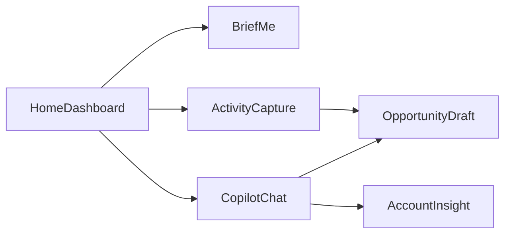

# 05 · 界面五屏

把四条设计原则落到一线最高频的五个屏幕。本文描述**界面终态与信息架构**；实现映射到本仓库 `src/` 目录约定见文末。

## 共同设计取舍

1. **主动作永远是橙色麦克风**；键盘是隐藏的 fallback  
2. 任何 AI 输出必须带「AI 草稿」标签和**置信度**；写入前一律可编辑  
3. **Agent 名字**明示在回答上方，让用户知道「是谁在回答」  
4. 移动端入口收敛为：**对话 · 看板 · 任务**



## 屏 1 · 今日大盘 HomeDashboard

**目的：** 开机即得「今日态势」，不是空仪表盘。

| 区块 | 内容 |
| --- | --- |
| 身份 | 当前用户 / 区域 |
| KPI | 4 张关键指标卡 |
| AI 摘要 | 今日摘要（指标分析 + 客户画像拼装） |
| 快捷入口 | 语音播报、新拜访 |
| 底部 | 常驻语音气泡（橙麦） |

**原则：** 单一焦点；首屏不堆次要营销/元数据。

## 屏 2 · 今日播报 Brief Me

**目的：** 单张 BriefCard 承载今日全部背景。

| 元素 | 行为 |
| --- | --- |
| 摘要 + 要点 | 可读可播 |
| Metric chip | 关键数字 |
| CTA | 加入今日任务 |
| 底部气泡 | 短按播放、长按对话 |
| 倍速 chip | 1× / 1.5× / 2× |
| Dots | 切换章节 |

对齐原则 02（Voice-First）+ 03（Confirm）。

## 屏 3 · 活动录入 ActivityCapture

**目的：** 语音 → 拜访摘要 + 商机草稿 + 跟进动作；用户只做确认 / 编辑 / 重录。

| 状态 | UI |
| --- | --- |
| 录音中 | 波形 / 时长；松开关闭 |
| 转写中 | 转写文本可改 |
| 草稿就绪 | 活动卡 + 商机卡（可左右滑） |
| 确认后 | 同步状态：草稿 → 确认 → SAP 同步中/完成/失败 |

示例上下文条：`最近 30 天 4 次拜访 · NPS 提升 12 点 · 上次接触 04/22`

## 屏 4 · 客户信息查询 AccountInsight / CopilotChat

**目的：** 用户表达意图，Orchestrator 调用客户画像 + 商机评估等 Agent 并合成回答，无需菜单。

| 元素 | 说明 |
| --- | --- |
| Agent 标签 | 如「客户画像 Agent」 |
| 合成回答 | Message Envelope `content` |
| 来源行 | `sources[]` chips |
| 置信度 | 整体或分段 confidence |

对齐原则 04（Agent 编排）。

## 屏 5 · 商机创建 OpportunityDraft

**目的：** AI 生成商机结果带信心度 + 来源 + 一键编辑；写入走草稿三段式，绝不黑盒提交。

示例字段（可编辑）：

| 字段 | 示例 |
| --- | --- |
| 客户 | Hospital Alpha |
| 产品线 | A1 监护仪 |
| 数量 | 8 台 |
| 预计金额 | USD 96,000 |
| 阶段 | Identify |
| 预计成交 | 2026 Q3 |
| 整体信心度 | 78% |
| 溯源 | 04/29 拜访活动 · 历史成交参考 |

督导 Agent 的阶段建议以非阻断提示展示，用户可接受或忽略后 Confirm。

## 与 `src/` 模块映射建议

当前仓库已按下列目录落地（[`src/App.tsx`](../src/App.tsx) 挂载 `AppShell`）：

```
src/
  app/
    AppShell.tsx          # 三入口壳：对话 / 看板 / 任务
  screens/
    HomeDashboard.tsx
    BriefMe.tsx
    ActivityCapture.tsx
    AccountInsight.tsx
    OpportunityDraft.tsx
    CopilotChat.tsx
  components/
    MicButton.tsx         # 常驻橙麦
    DraftCard.tsx         # AI 草稿 + 置信度 + 编辑
    SourceChips.tsx
    SyncStatusBadge.tsx   # 草稿/确认/同步
    AgentLabel.tsx
  agents/
    types.ts              # Message Envelope 类型
    orchestratorClient.ts # 调用编排入口
  speech/
    useWebSpeech.ts
  data/
    dataverse.ts
    syncStatus.ts
```

详细开工步骤见 [12 Phase 1 开工指南](12-phase1-build-guide.md)。

## 无障碍与环境约束

| 约束 | 要求 |
| --- | --- |
| 单手 | 主 CTA 拇指可达区 |
| 户外 | 对比度足够；避免依赖细线图标 |
| 离线 | 活动口述可本地缓存，恢复后补传 |
| 语音失败 | 显式切换键盘输入，不静默失败 |

## 相关文档

- [01 产品总览](01-product-overview.md)
- [03 Agent 架构](03-agent-architecture.md)
- [12 Phase 1 开工指南](12-phase1-build-guide.md)
