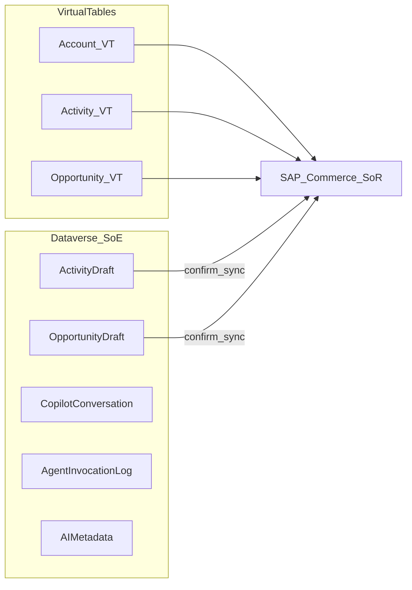
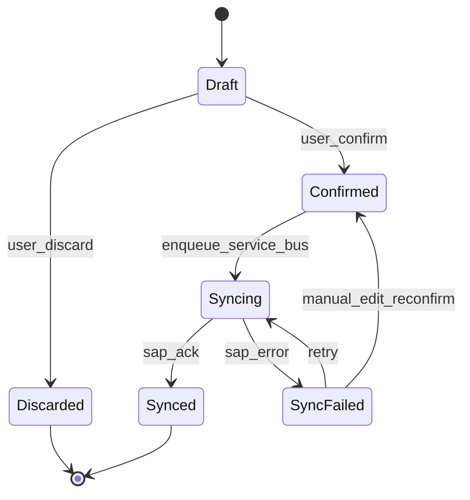

# 06 · 数据模型

**SAP Commerce 仍是 System of Record；Dataverse 仅作 AI / 移动 System of Engagement。**  
读取以 Virtual Tables 为主；写入走草稿三段式后异步回写 SAP。

## 概念模型

## 同步状态机

所有可回写业务对象共用状态：

| 状态 | UI 表现 | 可否改 |
| --- | --- | --- |
| Draft | 「AI 草稿」标签 | 可编辑 / 拒绝 |
| Confirmed | 已确认，等待同步 | 锁定或走变更流程 |
| Syncing | 同步中 | 否 |
| Synced | 已写入 SAP，显示外部 ID | 否（变更另开草稿） |
| SyncFailed | 失败原因 + 重试 | 可重试 / 人工补偿 |
| Discarded | 已丢弃 | 否 |

## Dataverse 表（SoE 原生）

命名可按 Solution 发布商前缀调整；下列为逻辑名。

### ActivityDraft（活动草稿）

| 字段 | 类型 | 说明 |
| --- | --- | --- |
| activitydraftid | GUID | PK |
| subject | string | 主题 |
| summary | memo | AI 摘要 |
| visittype | choice | Visit 等 |
| scheduledstart / end | datetime | 起止 |
| regardingaccountid | lookup / GUID | 关联客户（可指向 VT） |
| contactname | string | 联系人（抽取） |
| followupat | datetime | 下次跟进 |
| transcript | memo | 原始转写 |
| syncstatus | choice | 状态机 |
| sapexternalid | string | 同步成功后回填 |
| confidence | decimal | 整体置信度 |
| sourcesjson | memo | `sources[]` 序列化 |
| idempotencykey | string | 回写幂等键 |
| createdbyagent | string | 产出 Agent 名 |

### OpportunityDraft（商机草稿）

| 字段 | 类型 | 说明 |
| --- | --- | --- |
| opportunitydraftid | GUID | PK |
| name | string | 商机名 |
| accountid | lookup / GUID | 客户 |
| productline | string | 产品线 |
| quantity | number | 数量 |
| estimatedvalue | money | 预计金额 |
| stage | string / choice | Identify 等 |
| closedate | date | 预计成交 |
| confidence | decimal | 信心度 |
| reuseexisting | bool | 是否追加既有商机 |
| existingopportunityref | string | 既有商机引用 |
| supervisorhints | memo | 督导建议 JSON |
| syncstatus | choice | 状态机 |
| linkedactivitydraftid | lookup | 来源活动草稿 |
| idempotencykey | string | 幂等键 |

### CopilotConversation（会话与共享记忆）

| 字段 | 类型 | 说明 |
| --- | --- | --- |
| conversationid | GUID | PK |
| userid | lookup | 销售用户 |
| contextjson | memo | Shared Memory（accountId 等） |
| agentchainjson | memo | 最近 `agent_chain` |
| lastmessageat | datetime | 最后消息时间 |

### AgentInvocationLog（调用日志）

| 字段 | 类型 | 说明 |
| --- | --- | --- |
| invocationid | GUID | PK |
| conversationid | lookup | 会话 |
| agentname | string | Agent |
| latencyms | number | 耗时 |
| success | bool | 是否成功 |
| confidencesnapshot | decimal | 置信度快照 |
| errormessage | memo | 错误 |
| creditsestimate | number | 可选：Credits 估算 |

### AIMetadata（通用 AI 元数据）

用于跨实体摘要、分类标签、提示词版本等可审计字段；可与草稿表合并或 1:N 关联。

## Virtual Tables（读路径）

Phase 1 最少覆盖三个核心实体：

| 虚拟表 | SAP 实体（逻辑） | 主要用途 |
| --- | --- | --- |
| Account_VT | 客户 / 医院 | 画像、去重、信用 |
| Activity_VT | 活动 / 拜访 | 历史拜访、关联证据 |
| Opportunity_VT | 商机 | 重复检测、阶段 |

字段集以「一线查询 + Agent 工具所需」为最小集，避免把桌面 CRM 全字段搬进 VT。

## Blob 与知识

| 存储 | 内容 | 阶段 |
| --- | --- | --- |
| Azure Blob | 拜访照片、设备铭牌 | 1+ |
| SharePoint + Dataverse 知识源 | RAG | 3 |
| Azure AI Search 索引 | 售后语义检索 | 3 |

## 与前端类型对齐

前端 [`agents/types.ts`](05-ui-screens.md) 中的 `draft` 应可映射到 ActivityDraft / OpportunityDraft；`SyncStatusBadge` 直接绑定 `syncstatus`。

## 相关文档

- [02 系统架构](02-system-architecture.md)
- [07 SAP 集成](07-integration-sap.md)
- [03 Agent 架构](03-agent-architecture.md)
