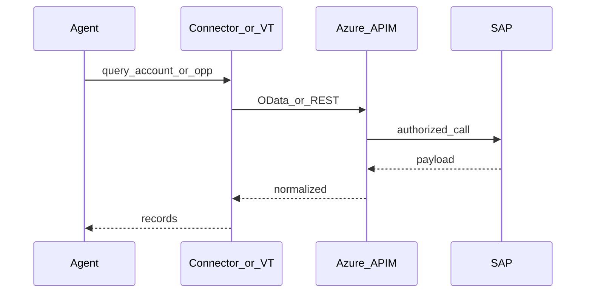
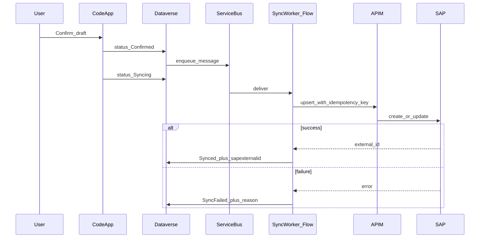

# 07 · SAP 集成

> **Demo 期不实施本文。** 当前无真实 Virtual Tables / Service Bus / APIM；用 Dataverse 普通表种子 + `syncstatus=synced` 模拟回写。见 [14](14-demo-plan.md) · [15](15-demo-scope-matrix.md) · [13](13-dataverse-table-spec.md)。本文保留为生产接轨规格。

目标：**不替换 SAP 底座、不对 SAP 做侵入式定制**；读快、写稳、可审计、可补偿。

## 集成原则

1. SAP Commerce CRM = **唯一 SoR**  
2. Dataverse = **SoE**（草稿、会话、日志、AI 元数据）  
3. 读：Virtual Tables（+ 必要的近实时缓存）  
4. 写：用户 Confirm 后经 **APIM → Service Bus → SAP API** 异步落地  
5. 所有写操作带 **幂等键**；失败可重试、可人工补偿  

## 读路径

| 组件 | 职责 |
| --- | --- |
| Virtual Tables | Dataverse 内「像本地表一样」查询 SAP 实体 |
| Custom Connector | Agent / Flow / Code App 调用 SAP REST |
| Azure APIM | 统一鉴权、限流、日志、版本 |

Phase 1 实体：客户、活动、商机。列表查询需关注跨境延迟——Agent 工具应取**最小字段集**，并设超时与降级文案。

## 写路径（草稿三段式）

### 消息体建议字段

| 字段 | 说明 |
| --- | --- |
| `entityType` | Activity / Opportunity / … |
| `draftId` | Dataverse 草稿 ID |
| `idempotencyKey` | 全局唯一，SAP 侧去重 |
| `payload` | 规范化业务字段 |
| `requestedBy` | 用户 OID |
| `attempt` | 重试次数 |
| `correlationId` | 链路追踪（App Insights） |

## 幂等与冲突

| 场景 | 策略 |
| --- | --- |
| 用户重复点 Confirm | 同一 `idempotencyKey`；SAP / Worker 去重 |
| 网络重试 | Service Bus 至少一次投递 + 幂等消费 |
| 商机已存在 | 商机创建 Agent 建议 reuse；写路径更新关联活动而非新建 |
| SAP 校验失败 | `SyncFailed` + 可读错误；允许改草稿再确认 |
| 部分成功 | 禁止静默；状态机不进入 Synced，直至 ACK |

## 安全

| 项 | 做法 |
| --- | --- |
| 凭据 | Azure Key Vault；禁止写入前端或 Git |
| 身份 | Entra ID；映射既有 SAP 角色 |
| 边界 | Power Platform DLP 限制连接器 |
| 传输 | 仅经 APIM HTTPS；内网或 Private Link（按客户网络基线） |

## 可观测

在 App Insights / Monitor 至少跟踪：

| 指标 | 用途 |
| --- | --- |
| SAP 写入时延 P50/P95 | 同步体验 |
| 回写成功率 | 集成健康 |
| SyncFailed 率与 Top 错误 | 补偿优先级 |
| VT 查询时延 | 读路径调优 |

端到端用 `correlationId` 串联：Code App → Dataverse → Service Bus → Worker → APIM → SAP。

## 与方案 A/B 的边界

| 不做 | 原因 |
| --- | --- |
| 全量双写整迁 | 冲突与合规成本过高 |
| Agent 同步阻塞等待 SAP 写完再回 UI | 跨境延迟破坏 ≤30s / 3s draft 体验 |
| 前端直连 SAP | 绕过治理与密钥托管 |

Confirm 后 UI **立即**进入 Syncing，后台完成 SoR 写入。

## Phase 落地

| 阶段 | 集成范围 |
| --- | --- |
| Phase 1 | Custom Connector + VT（客户/活动/商机）；活动写路径可先落 Dataverse，SAP 回写可灰度 |
| Phase 2 | 异步回写流程生产化；订单/物流只读查询 |
| Phase 3+ | 售后相关实体与知识检索；写路径扩展需独立 Review-Loop |

## 相关文档

- [06 数据模型](06-data-model.md)
- [02 系统架构](02-system-architecture.md)
- [09 实施计划](09-implementation-roadmap.md)
