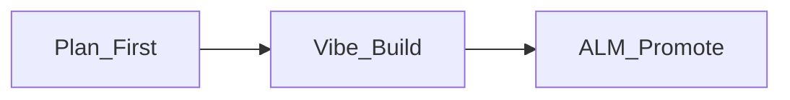
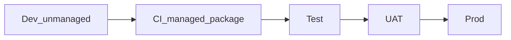

# 08 · ALM 交付方式

交付口号：**Plan-First · Vibe Build · ALM Promote**。  
不是瀑布，也不是纯 vibe coding；对齐 Microsoft Power Platform ALM + Plan Designer。

## 三段式总览



| 阶段 | 一句话 | 主要产出 |
| --- | --- | --- |
| Plan-First | 一句话 → v0 Plan | 角色、Data Model、Phase 1 技术清单 |
| Vibe Build | Bootstrap + 一屏一 Prompt | Code App 原型屏；Pro-Code 补集成 |
| ALM Promote | Solution 化 + Pipeline | Dev → Test → UAT → Prod |

详细日历见 [09 实施计划](09-implementation-roadmap.md)。

## 阶段 1 · Plan-First

1. 进入 Power Apps **Plan Designer**  
2. Requirement / Data / Solution 三个官方 Agent 接力生成：用户角色、Dataverse 表、推荐技术栈  
3. **三轮人审**收敛到 SAP 共生边界（VT + 异步回写，非整迁）  
4. **锁定** Data Model + Phase 1 技术清单后再大规模编码  

本仓库文档中的 [06 数据模型](06-data-model.md) 即 Plan 锁定结果的工程化表述，Plan Designer 输出应与之对齐并回写本文档。

## 阶段 2 · Vibe Build

### 做法

| 步骤 | 内容 |
| --- | --- |
| Bootstrap | 一个提示词拉起 App 壳（三入口 + 橙麦） |
| 一屏一 Prompt | Home / Brief / Capture / Chat / Opportunity 逐屏生成 |
| 契约优先 | 先实现 Message Envelope 类型与 DraftCard，再填业务 |

### Vibe vs Pro-Code 边界（硬规则）

| 适合 Vibe / 低代码 | 必须 Pro-Code |
| --- | --- |
| 屏布局、文案、草稿卡交互 | SAP Custom Connector / APIM 策略 |
| AI Builder Prompt 草稿 | 性能敏感列表与缓存 |
| 简单 Dataverse 表单 | 安全审计、PII 屏蔽校验 |
| Agent Instructions 初稿 | Service Bus 消费者、幂等与补偿 |
| | PCF / Plug-in（若需要） |

**不靠默契：** 集成、安全、跨境性能相关变更必须走 Pro-Code 评审。

## 阶段 3 · ALM Promote

### 源码与 Solution 同仓

| 资产 | 存放 |
| --- | --- |
| Code App（本仓库 `src/`） | Git |
| Prompt / Agent Instructions | Git（与 Solution 解包目录并列，如 `solution/` / `prompts/`） |
| Dataverse 表、安全角色 | unmanaged Solution → SolutionPackager 解包进 Git |
| 连接器定义 | Solution + 文档化环境变量 |

### Pipeline



| 规则 | 说明 |
| --- | --- |
| Patch | 热修走 hotfix Pipeline |
| Upgrade | 小版本走 Upgrade |
| 环境 | Managed Environments；DLP 按环境分级 |
| 监控 | App Insights：拜访完成率、Agent 成功率、SAP 写入时延 |

### 本仓库建议目录（后续落地）

```
/
  src/                 # Code App
  docs/                # 本套件
  prompts/             # Agent / 屏级 Prompt（待建）
  solution/            # SolutionPackager 解包（待建）
  power.config.json
```

## 质量门禁（进入下一环境前）

| 门禁 | 标准 |
| --- | --- |
| 契约 | Envelope 含 sources + confidence；写必经 draft |
| 安全 | 无密钥入仓；DLP 通过 |
| 集成 | SyncFailed 可重试；幂等键覆盖主路径 |
| 体验 | Phase 1：拜访草稿路径可演示；目标 ≤30s 录入 |
| 文档 | 变更同步更新 `docs/` 对应章节 |

## 相关文档

- [09 实施计划](09-implementation-roadmap.md)
- [12 Phase 1 开工指南](12-phase1-build-guide.md)
- [10 产品配置 SKU](10-product-sku.md)
