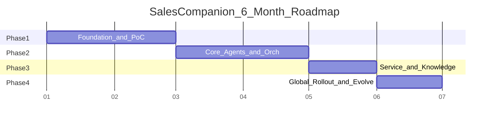
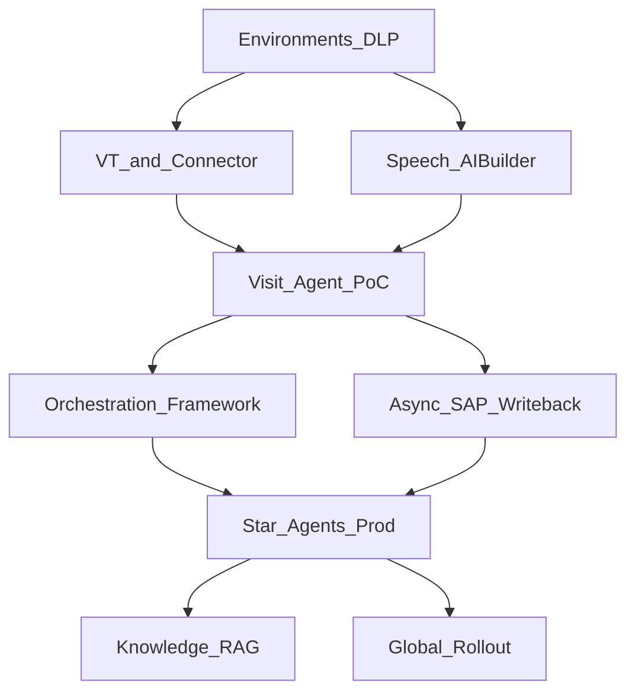

# 09 · 实施计划（6 个月四阶段）

本文是 SalesCompanion **完整实施计划**主文档。原则：避免一次性大爆炸上线；每阶段有可衡量价值与回退点；**3 个月内**首个生产 Agent 服务真实销售；**6 个月**覆盖 Phase 1 ★ 高频 Agent。

提案原文：[实施路线图](https://illusion615.github.io/KnowledgeHub/posts/mindray-crm-ai-proposal/index.html)。

## 总览时间线

| 阶段 | 时间 | 关键里程碑 |
| --- | --- | --- |
| Phase 1 | M0–M2 | **客户拜访 Agent** 在试点区域可用 |
| Phase 2 | M3–M4 | Phase 1 ★ Agent 全部投产 + 编排框架 |
| Phase 3 | M5 | 售后场景闭环 |
| Phase 4 | M6+ | 全球推广 + 持续演进 |

> 月份可按项目启动日平移；上表以相对月份为准。

## 角色 RACI（占位）

| 活动 | 业务 Sponsor | 产品 | 架构 | 前端 Code App | Maker / Copilot | 集成（SAP/Azure） | 安全合规 |
| --- | --- | --- | --- | --- | --- | --- | --- |
| 范围与里程碑 | A | R | C | I | I | C | C |
| 数据模型锁定 | C | C | A/R | I | C | R | C |
| Code App 五屏 | I | C | C | R | C | I | I |
| Agent Instructions | C | C | C | I | R | I | C |
| SAP 读写集成 | I | I | A | C | I | R | C |
| DLP / 环境 | I | I | C | I | I | C | A/R |
| 试点运营与 NPS | A | R | I | C | C | I | I |
| 生产发布 | A | C | C | R | R | R | C |

R = Responsible，A = Accountable，C = Consulted，I = Informed。

## 风险控制三原则（全程）

1. **任何 AI 写入均经「草稿确认」**，不直接覆盖 SAP  
2. **每个 Agent 可独立下线 / 灰度**，不影响其他流程  
3. **每阶段结束测量销售真实满意度**（NPS + 关键流程节省时间）；未达标禁止进入下一阶段  

## Phase 1 · M0–M2：地基 + 概念验证

**时长：** 2 个月  
**关键里程碑：** 客户拜访 Agent 在试点区域可用  

### 目标

打通「设备语音 → AI Builder 抽取 → 活动/商机草稿 → Confirm」端到端；1 个区域（如巴西）· **10 名**销售真实使用并收集语料。

### 工作包

| ID | 工作包 | 交付物 |
| --- | --- | --- |
| P1-W1 | 环境拓扑与 DLP | Dev / UAT / Prod / 沙盒；DLP 策略文档 |
| P1-W2 | SAP 接入 | Custom Connector + VT（客户、活动、商机） |
| P1-W3 | Code App 最小体验 | 主页 + 语音录入 + 拜访/草稿卡（本仓库） |
| P1-W4 | 认知链路 | Web Speech → AI Builder Prompt 字段抽取 |
| P1-W5 | 首批 Agent | 客户拜访、活动创建、商机创建/督导（草稿级） |
| P1-W6 | 试点运营 | 10 人清单、培训、反馈问卷、语料库 |

### 验收标准

| 编号 | 标准 |
| --- | --- |
| P1-A1 | 试点用户可在移动端用语音生成活动草稿并 Confirm |
| P1-A2 | 草稿展示置信度、来源、可编辑；无静默直写 SAP |
| P1-A3 | 主路径录入体验目标 ≤30 秒（记录分布，建基线） |
| P1-A4 | VT 可查询客户/活动/商机最小字段集 |
| P1-A5 | Dev→UAT 至少完成一次 Pipeline 部署 |
| P1-A6 | 收集可用语料与编辑/拒绝样本（提示词优化） |

### 回退点

- Agent / AI Builder 不可用 → 保留手动表单 fallback（最少字段）  
- SAP 写不通 → Confirm 仅落 Dataverse，`SyncFailed` 可补偿，不阻塞试点学习  
- 语音不可用 → 键盘转写输入  

### 退出准则（进入 Phase 2）

试点 NPS/CSAT 达约定门槛；P1-A1–A5 通过；已知缺陷有 Owner 与日期。

---

## Phase 2 · M3–M4：核心 Agent + 编排框架

**时长：** 2 个月  
**关键里程碑：** Phase 1 ★ Agent 全部投产  

### 目标

Copilot Studio 编排框架成型；商机评估、订单查询、物流查询、客户画像、工作总结等上线；异步回写生产化；试点扩至 **3 区域 · 100 名**销售；建立 AI 质量基线。

### 工作包

| ID | 工作包 | 交付物 |
| --- | --- | --- |
| P2-W1 | 编排框架 | 注册中心、统一对话入口、Orchestrator 配置 |
| P2-W2 | ★ Agent 全集 | 见 [04](04-agent-catalog.md) Phase 1/2 ★ |
| P2-W3 | 异步回写 | 草稿→确认→Service Bus→SAP；监控与重试 |
| P2-W4 | Brief Me / 看板 | 指标分析驱动的播报与 KPI |
| P2-W5 | 质量基线 | 意图准确率、草稿采纳率、平均节省时间看板 |
| P2-W6 | 扩量试点 | 100 人启用、区域管理员手册 |

### 验收标准

| 编号 | 标准 |
| --- | --- |
| P2-A1 | Generative Orchestration 可调度 ≥ Phase 1 ★ Agent |
| P2-A2 | Fan-out / Sequential / Review-Loop 各有可演示案例 |
| P2-A3 | SAP 回写成功率达约定阈值；SyncFailed 可运维 |
| P2-A4 | 质量基线指标可在看板周更 |
| P2-A5 | 100 名用户完成 onboarding |

### 回退点

- 单 Agent 异常 → 灰度下线该 Agent，Orchestrator 降级提示  
- 回写大面积失败 → 暂停写路径扩量，读路径与草稿仍可用  

### 退出准则

★ Agent 生产可用；基线达标或有经 Sponsor 批准的豁免；NPS 复测完成。

---

## Phase 3 · M5：售后与知识拓展

**时长：** 1 个月  
**关键里程碑：** 覆盖售后场景闭环  

### 工作包

| ID | 工作包 | 交付物 |
| --- | --- | --- |
| P3-W1 | 售后 Agent | 维修知识检索、现场服务、备件推荐 |
| P3-W2 | 智能知识库 | SharePoint + Dataverse +（可选）AI Search RAG |
| P3-W3 | Teams 入口 | 会议中临时查询 Copilot |
| P3-W4 | 运营看板 | 自定义页面 + 考核管理洞察 |

### 验收标准

| 编号 | 标准 |
| --- | --- |
| P3-A1 | 故障知识问答主路径 ≤10 秒级响应（网络正常） |
| P3-A2 | 知识源权限与 DLP 合规 |
| P3-A3 | Teams 入口可完成只读查询演示 |

### 回退点

知识检索质量不足 → 回退到固定知识文章链接；不阻断销售主路径 Agent。

---

## Phase 4 · M6 及以后：全球推广 + 持续演进

**关键里程碑：** 覆盖全部目标销售人员  

### 工作包

| ID | 工作包 | 交付物 |
| --- | --- | --- |
| P4-W1 | 全球分批接入 | 欧 / 亚太 / 北美 / 中东等批次计划 |
| P4-W2 | Agent 运营机制 | 月度 prompt/工具优化；新 Agent 评审会 |
| P4-W3 | 高阶 Agent | 预测性维护、销售预测等 |
| P4-W4 | Citizen Developer | 区域 Maker 培训与贡献流程 |

### 验收标准

| 编号 | 标准 |
| --- | --- |
| P4-A1 | 各区域批次有独立成功标准与回退 |
| P4-A2 | 月度运营例行运转（议程、指标、变更记录） |
| P4-A3 | 至少 1 个由区域 Maker 主导的 Agent 增强合入 |

## 跨阶段依赖

## 沟通与治理节奏建议

| 节奏 | 内容 |
| --- | --- |
| 双周 | 迭代演示（屏 + Agent） |
| 月度 | 指标复盘（见 [11](11-success-metrics.md)） |
| 阶段末 | 门禁评审：验收 + NPS + Go/No-Go |
| 变更 | Agent 上下线走评审；紧急下线可事后补单 |

## 与本仓库的关系

| 阶段 | 本仓库重点 |
| --- | --- |
| Phase 1 | 五屏骨架、语音、DraftCard、编排客户端、同步状态 UI |
| Phase 2 | CopilotChat 多 Agent 渲染、Brief Me、错误与降级体验 |
| Phase 3 | 知识答案卡片、Teams 深链（若需要） |
| Phase 4 | 多语言文案、区域特性开关 |

开工清单：[12 Phase 1 开工指南](12-phase1-build-guide.md)。

## 相关文档

- [08 ALM 交付](08-alm-delivery.md)
- [10 产品配置 SKU](10-product-sku.md)
- [11 成功指标](11-success-metrics.md)
- [04 Agent 全景目录](04-agent-catalog.md)
