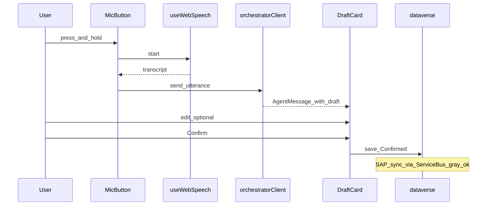

# 12 · Phase 1 / Demo 开工指南（本仓库）

把提案落到 **SalesCompanion** 的可执行检查清单。

> **当前冲刺以 Demo 为准：** [14 Demo 计划](14-demo-plan.md) · [15 范围矩阵](15-demo-scope-matrix.md) · [13 建表](13-dataverse-table-spec.md)。  
> 原 6 个月门禁见 [09](09-implementation-roadmap.md)（愿景，不阻塞 Demo）。

### Demo 必做 vs 本仓库已有 UI

| Demo 项 | 仓库现状 |
| --- | --- |
| 活动录入 + 草稿 Confirm | ✅ `server` 编排 + Confirm→Synced；前端已接 `/api` |
| 客户速览对话 | ✅ 场景 B |
| 订单/物流（选做） | ✅ 场景 C + 种子 order/shipment |
| Home 简化 KPI | ✅ `/api/metrics` + Dataverse 种子聚合 |
| 任务中心 / 客户画像 | ✅ 选做已接通 API |
| Brief Me | 已有 UI；**可不纳入验收** |
| Dataverse 普通表（VT 替身） | ✅ 内存种子 `dataverse/seed`；真实环境按 13 建表 |
| 真实 VT / SB / Copilot / AI Builder | **明确不做** |

## 当前仓库基线

| 项 | 状态 |
| --- | --- |
| 栈 | React 19 + Vite 7 + TypeScript + `@microsoft/power-apps` |
| 应用名 | [`power.config.json`](../power.config.json) → `SalesCompanion` |
| 环境 ID | 已写入 `environmentId`（按项目实际校验） |
| UI | [`src/App.tsx`](../src/App.tsx) → `AppShell`；五屏 + 任务/客户画像已落地 |
| 连接器 / Dataverse | `connectionReferences` / `databaseReferences` 仍为空；本地 SoE（localStorage）跑通主路径 |
| 建表规格 | [13 Dataverse 表字段规格](13-dataverse-table-spec.md) |
| 文档 | `docs/` 本套件 |

## Phase 1 成功定义（对本仓库）

一条生产路径跑通：

**按住橙麦说话 → Web Speech 转写 → AI Builder / 编排抽取 → 活动草稿卡 (+ 可选商机草稿) → 用户 Confirm → Dataverse 落库（SAP 回写可灰度）**

验收硬条件：

- [x] 录入主路径体验目标 **≤ 30 秒**（UI 已显示耗时；试点期再采分布）  
- [x] 草稿**可编辑**；展示 **来源 + 置信度**（`DraftCard`）  
- [x] **不直写 SAP**；状态可见（Draft / Confirmed / Syncing / …，本地 mock 回写）  
- [x] Agent 名称可见于回答上方（`AgentLabel`）  

> 代码已落地：`src/app` · `screens` · `components` · `agents` · `speech` · `data`。编排层当前为 **Mock Orchestrator**（仁济示例），接通 Copilot Studio 后保持 `orchestrate()` 签名不变。

## 环境与平台前置

| # | 任务 | Owner 占位 |
| --- | --- | --- |
| 1 | 确认 Dev / UAT / Prod / 沙盒与 DLP | 平台 / 安全 |
| 2 | 开通 Power Apps Premium 试点用户 | 采购 / IT |
| 3 | 创建 AI Builder Prompt（拜访字段 schema） | Maker |
| 4 | Custom Connector + VT：客户 / 活动 / 商机 | 集成 |
| 5 | Copilot Studio：拜访 / 活动 / 商机(+督导) Agent 草稿版 | Maker |
| 6 | 更新 `power.config.json` 的 connection / database 引用 | 前端 |
| 7 | App Insights instrumentation key / 连接串（环境变量） | 前端 / 平台 |

## 建议目录落地顺序

按 [05 界面五屏](05-ui-screens.md) 映射创建：

```
src/
  app/AppShell.tsx
  screens/HomeDashboard.tsx
  screens/BriefMe.tsx
  screens/ActivityCapture.tsx
  screens/CopilotChat.tsx
  screens/OpportunityDraft.tsx
  components/MicButton.tsx
  components/DraftCard.tsx
  components/SourceChips.tsx
  components/SyncStatusBadge.tsx
  components/AgentLabel.tsx
  agents/types.ts
  agents/orchestratorClient.ts
  speech/useWebSpeech.ts
  data/dataverse.ts
  data/syncStatus.ts
```

### 推荐实现顺序

1. **`agents/types.ts`** — Message Envelope / Draft / Source 类型（契约先行）  
2. **`MicButton` + `useWebSpeech`** — 权限、错误、键盘 fallback  
3. **`DraftCard` + `SyncStatusBadge` + `SourceChips` + `AgentLabel`** — 可复用展示  
4. **`ActivityCapture`** — 主路径屏  
5. **`orchestratorClient`** — 对接 Copilot Studio / 自定义 API（先 mock 再真连）  
6. **`HomeDashboard`** — KPI 可先静态 / mock，再接指标分析 Agent  
7. **`OpportunityDraft`** — 与活动 Confirm 联动  
8. **`BriefMe` / `CopilotChat`** — Phase 1 可后置但建议保留壳  

## 首个生产路径（详细）



### Mock 策略（未接通平台时）

- `orchestratorClient` 返回固定 Envelope（仁济医院示例，见 [03](03-agent-architecture.md)）  
- `syncstatus` 在 Confirm 后本地模拟 Syncing → Synced  
- 接通后删除 mock，保留接口不变  

## `power.config.json` 检查清单

| 字段 | Phase 1 期望 |
| --- | --- |
| `appDisplayName` | `SalesCompanion` |
| `appType` | `CodeApp` |
| `buildPath` | `./dist` |
| `connectionReferences` | AI Builder / Custom Connector / 编排相关引用 |
| `databaseReferences` | ActivityDraft 等表 / VT |

具体键名以 Power Apps CLI / 环境导出为准，更新后同步本文。

## 测试与试点

| 类型 | 内容 |
| --- | --- |
| 单测 / 组件测 | Envelope 渲染、状态机文案、语音 fallback |
| 真机 | iOS Safari / Android Chrome Web Speech |
| 试点 | 10 名销售；收集拒绝/编辑语料 |
| 指标 | A1 耗时、采纳率；见 [11](11-success-metrics.md) |

## Definition of Done（开发迭代）

- [ ] 类型与 [03 消息契约](03-agent-architecture.md) 一致  
- [ ] 无密钥写入源码；敏感配置走环境 / Key Vault  
- [ ] 写路径必经 Confirm  
- [ ] 失败可重试或可读错误  
- [ ] 变更同步更新相关 `docs/` 章节  

## 明确不在 Phase 1 本仓库范围

- 售后 RAG / AI Search  
- 全球多区域特性开关完备化  
- Model Driven 管理后台全量  
- 预测性维护等高阶 Agent  

## 相关文档

- [05 界面五屏](05-ui-screens.md)
- [06 数据模型](06-data-model.md)
- [13 Dataverse 表字段规格](13-dataverse-table-spec.md)
- [07 SAP 集成](07-integration-sap.md)
- [08 ALM 交付](08-alm-delivery.md)
- [09 实施计划](09-implementation-roadmap.md)
