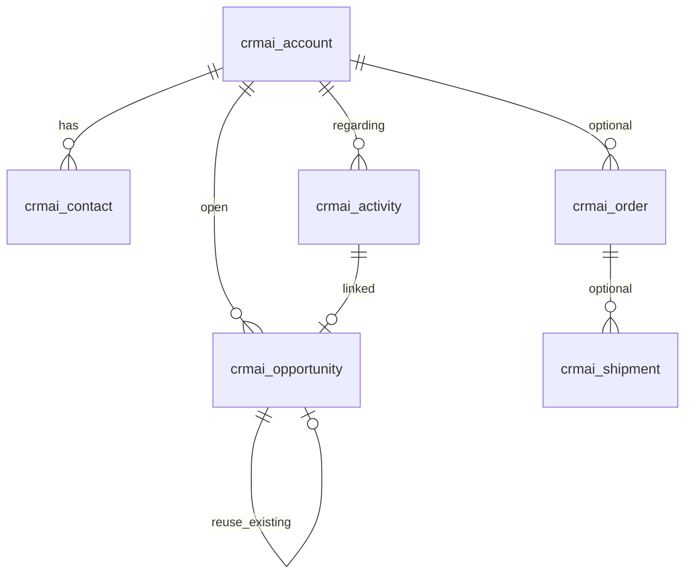

# 13 · Dataverse 表字段规格（Demo 建表手册）

> **当前执行范围 = [14 Demo 计划](14-demo-plan.md) + [15 范围矩阵](15-demo-scope-matrix.md)。**  
> 本文按 Demo 环境约束编写：**无真实 Virtual Tables、无 Service Bus**；业务实体用**普通自定义表 + 种子数据**临时代替未来 SAP/VT。

概念对照仍可读 [06 数据模型](06-data-model.md)（生产愿景）；**建表以本文为准。**

---

## 0. 建哪些 / 不建哪些

| 优先级 | 表逻辑名（前缀示例 `crmai_`） | 说明 |
| --- | --- | --- |
| **必建** | `crmai_account` | 客户（VT 替身 + 种子） |
| **必建** | `crmai_contact` | 联系人 |
| **必建** | `crmai_activity` | 活动/拜访（AI 草稿操作面） |
| **必建** | `crmai_opportunity` | 商机（种子既有行 + AI 草稿行） |
| **必建** | `crmai_aiinvocationlog` | Agent 调用审计 |
| **选建** | `crmai_order` | 场景 C 订单 |
| **选建** | `crmai_shipment` | 场景 C 物流 |
| **选建** | `crmai_conversation` | 多轮 Shared Memory（可先本地） |
| **不建（Demo）** | 任何 `*_vt` Virtual Table | 无 SAP VT |
| **不建（Demo）** | 独立 `aimetadata` 大表 | Prompt 版本写入 invocation log / activity 即可 |
| **不建（Demo）** | `offlineutterance` | 不做多设备离线表 |
| **不建（Demo）** | Service Bus / APIM 实体 | `synced` 状态模拟即可 |

> 发布商前缀以环境实际为准（`crmai_` / `sc_` / 其他均可）；**列语义保持一致**，便于日后换成真实 VT。

---

## 1. 建表约定

| 项 | Demo 约定 |
| --- | --- |
| Solution | `SalesCompanionDemo`（或并入现有 Dev Solution） |
| 前缀 | `crmai_`（下表按此书写） |
| 主键 | 系统 GUID |
| 所有权 | User owned（演示账号可写草稿、可读种子） |
| 权威数据 | **仅 Dataverse**；前端勿再把 localStorage 当 SoR（可作离线缓存） |
| 回写 SAP | **不接**；`crmai_syncstatus = synced` 表示「模拟已回写」 |

### 1.1 全局 Choice：`crmai_syncstatus`

| Value | Label | 说明 | 前端 |
| --- | ---: | --- | --- |
| 100000000 | draft | AI 草稿，可编辑/拒绝 | `Draft` |
| 100000001 | confirmed | 用户已确认 | `Confirmed` |
| 100000002 | synced | **模拟**已回写 SAP | `Synced` |
| 100000003 | discarded | 用户拒绝 | `Discarded` |

> Demo **可不建** `syncing` / `syncfailed`（计划状态机为 draft → confirmed → synced）。若前端已有 Syncing/SyncFailed，可保留两值作演示增强，**非验收硬项**。

### 1.2 Choice：`crmai_activitytype`

| Value | Label |
| --- | ---: |
| 100000000 | Visit |
| 100000001 | Call |
| 100000002 | Demo |
| 100000003 | FollowUp |

### 1.3 Choice：`crmai_oppstage`

| Value | Label |
| --- | ---: |
| 100000000 | Identify |
| 100000001 | Qualify |
| 100000002 | Propose |
| 100000003 | Negotiate |
| 100000004 | Closed |

---

## 2. `crmai_account` · 客户（必建 · VT 替身）

**用途：** 种子医院主数据；客户画像 Agent 查询源。日后可替换为真实 Account VT。

| 显示名 | 逻辑名 | 类型 | 必填 | 说明 | 种子示例 |
| --- | --- | --- | --- | --- | --- |
| 客户 | `crmai_accountid` | GUID PK | 是 | | |
| 名称 | `crmai_name` | Text (200) | 是 | 列表主字段 | 上海仁济医院 |
| 外部键 | `crmai_externalkey` | Text (100) | 是 | 如 `SAP-ACC-RENJI`；Alternate Key 建议 | SAP-ACC-RENJI |
| 区域 | `crmai_region` | Text (50) | 否 | | 华东 |
| 信用等级 | `crmai_creditlevel` | Text (20) | 否 | A/B/C | A |
| 上次拜访 | `crmai_lastvisitat` | DateTime | 否 | | 2026-04-22 |
| 近30天拜访数 | `crmai_visitcount30d` | Whole number | 否 | 可种子写死或聚合 | 4 |
| NPS 变化 | `crmai_npsdelta` | Text (20) | 否 | | +12 |
| 已签 MSA | `crmai_hasmsa` | Two options | 否 | | Yes |
| 摘要备注 | `crmai_notes` | Memo | 否 | 画像兜底文案 | |

**种子（至少）：** 上海仁济医院、Hospital Alpha，另加 1～3 家即可。

---

## 3. `crmai_contact` · 联系人（必建）

| 显示名 | 逻辑名 | 类型 | 必填 | 说明 |
| --- | --- | --- | --- | --- |
| 联系人 | `crmai_contactid` | GUID PK | 是 | |
| 名称 | `crmai_name` | Text (100) | 是 | 如「张主任」 |
| 客户 | `crmai_accountid` | Lookup → account | 是 | |
| 职位 | `crmai_title` | Text (100) | 否 | |
| 电话 | `crmai_phone` | Text (50) | 否 | Demo 可空 |
| 外部键 | `crmai_externalkey` | Text (100) | 否 | |

**种子：** 仁济 → 张主任（供抽取校验 / 画像引用）。

---

## 4. `crmai_activity` · 活动/拜访（必建 · AI 操作面）

**用途：** 拜访草稿写入与状态流转；Confirm 后仍在本表更新 `syncstatus`（无 SB）。

| 显示名 | 逻辑名 | 类型 | 必填 | 前端 / 说明 |
| --- | --- | --- | --- | --- |
| 活动 | `crmai_activityid` | GUID PK | 是 | |
| 主题 | `crmai_name` / `crmai_subject` | Text (200) | 是 | `subject`（可用 name 作主字段） |
| 客户 | `crmai_accountid` | Lookup → account | 否* | 能解析则填；否则先写名称 |
| 客户名称快照 | `crmai_accountname` | Text (200) | 是 | 抽取结果兜底 |
| 联系人 | `crmai_contactid` | Lookup → contact | 否 | |
| 联系人名称 | `crmai_contactname` | Text (100) | 否 | `contactName` |
| 类型 | `crmai_type` | Choice → activitytype | 是 | Visit… |
| 发生时间 | `crmai_occurredat` | DateTime | 否 | 拜访时刻 |
| 计划开始/结束 | `crmai_scheduledstart` / `end` | DateTime | 否 | |
| 摘要 | `crmai_summary` | Memo | 是 | `summary` |
| 下次跟进 | `crmai_nextfollowupat` | Date Only | 否 | `followUpAt` |
| 原始转写 | `crmai_sourcetranscript` | Memo | 是 | `transcript` |
| 同步状态 | `crmai_syncstatus` | Choice | 是 | 默认 draft |
| 置信度 | `crmai_confidence` | Decimal 0–1 | 是 | |
| 产出 Agent | `crmai_createdbyagent` | Text (100) | 是 | |
| 来源 JSON | `crmai_sourcesjson` | Memo | 否 | Envelope sources |
| 幂等键 | `crmai_idempotencykey` | Text (100) | 是 | **Alternate Key** |
| 模拟外部 ID | `crmai_sapexternalid` | Text (100) | 否 | synced 后可填伪 ID |
| 会话键 | `crmai_sessionkey` | Text (100) | 否 | 关联对话 |
| Prompt 版本 | `crmai_promptversion` | Text (50) | 否 | 如 `demo-deepseek-v1` |

\* Lookup 在种子客户命中时填写，便于 sources 指向真实记录 ID。

**写入状态机（Demo）：**

```
draft ──Confirm──► confirmed ──(短延迟模拟)──► synced
  │
  └──Discard──► discarded
```

---

## 5. `crmai_opportunity` · 商机（必建 · 种子 + 草稿）

**双重用途：**

1. **种子行**：既有商机（如仁济 N17 Identify）→ 督导「建议关联而非新建」  
2. **草稿行**：AI 新建/追加意向，带 `syncstatus`

| 显示名 | 逻辑名 | 类型 | 必填 | 说明 |
| --- | --- | --- | --- | --- |
| 商机 | `crmai_opportunityid` | GUID PK | 是 | |
| 名称 | `crmai_name` | Text (200) | 是 | |
| 客户 | `crmai_accountid` | Lookup → account | 是* | 种子必填 |
| 客户名称 | `crmai_accountname` | Text (200) | 否 | 快照 |
| 产品线 | `crmai_productline` | Text (100) | 是 | 监护仪 |
| 产品型号 | `crmai_productmodel` | Text (100) | 否 | N17 |
| 数量 | `crmai_quantity` | Whole number | 否 | |
| 金额 | `crmai_amount` | Currency / Decimal | 否 | |
| 货币代码 | `crmai_currencycode` | Text (3) | 否 | USD |
| 阶段 | `crmai_stage` | Choice → oppstage | 是 | |
| 信心分 | `crmai_confidencescore` | Decimal 0–1 | 否 | |
| 预计成交 | `crmai_closedate` | Date Only | 否 | |
| 同步状态 | `crmai_syncstatus` | Choice | 否** | 种子既有行可空或 synced；草稿为 draft |
| 是否追加既有 | `crmai_reuseexisting` | Two options | 否 | |
| 既有商机 | `crmai_existingopportunityid` | Lookup → opportunity | 否 | 自关联 |
| 督导提示 JSON | `crmai_supervisorhints` | Memo | 否 | `string[]` |
| 来源活动 | `crmai_linkedactivityid` | Lookup → activity | 否 | |
| 幂等键 | `crmai_idempotencykey` | Text (100) | 条件 | 草稿行必填 + Alternate Key |
| 产出 Agent | `crmai_createdbyagent` | Text (100) | 否 | 草稿行填写 |
| 来源 JSON | `crmai_sourcesjson` | Memo | 否 | |
| 原始转写/备注 | `crmai_notes` | Memo | 否 | |
| 外部键 | `crmai_externalkey` | Text (100) | 否 | 种子如 `SAP-OPP-N17` |

\* 草稿若客户未解析，可暂空 Lookup，仅填名称。  
\** 种子「正式」商机：可不走草稿机；AI 新建行必须有 syncstatus。

**种子必含：** 仁济 · 监护仪 N17 · Identify · externalkey=`SAP-OPP-N17`（场景 A 督导演示）。

---

## 6. `crmai_aiinvocationlog` · 调用日志（必建 · 治理）

| 显示名 | 逻辑名 | 类型 | 必填 | 说明 |
| --- | --- | --- | --- | --- |
| 日志 | `crmai_aiinvocationlogid` | GUID PK | 是 | |
| 名称 | `crmai_name` | Text (200) | 是 | `{agent}-{time}` |
| 会话 ID | `crmai_sessionid` | Text (100) | 否 | |
| Agent 名 | `crmai_agentname` | Text (100) | 是 | |
| 输入摘要 | `crmai_inputsummary` | Memo | 是 | 话术截断 |
| 输出信封 | `crmai_outputenvelope` | Memo | 否 | Envelope JSON |
| 耗时 ms | `crmai_latencyms` | Whole number | 是 | |
| 成功 | `crmai_success` | Two options | 是 | |
| 置信度 | `crmai_confidence` | Decimal | 否 | |
| 错误 | `crmai_errormessage` | Memo | 否 | |
| Prompt 版本 | `crmai_promptversion` | Text (50) | 否 | |
| 模型名 | `crmai_modelname` | Text (100) | 否 | 如 `deepseek-chat` |

---

## 7. 选建表（场景 C / 增强）

### 7.1 `crmai_order`（选建）

| 列 | 类型 | 说明 |
| --- | --- | --- |
| `crmai_orderid` | GUID | PK |
| `crmai_name` | Text | 订单号/标题 |
| `crmai_accountid` | Lookup | 客户 |
| `crmai_externalkey` | Text | |
| `crmai_status` | Text | 清关中 / 已发货… |
| `crmai_orderedat` | Date | |
| `crmai_amount` | Currency | |

### 7.2 `crmai_shipment`（选建）

| 列 | 类型 | 说明 |
| --- | --- | --- |
| `crmai_shipmentid` | GUID | PK |
| `crmai_name` | Text | |
| `crmai_orderid` | Lookup → order | |
| `crmai_status` | Text | |
| `crmai_eta` | Date | 预计交付 |
| `crmai_trackingno` | Text | |

### 7.3 `crmai_conversation`（选建）

| 列 | 类型 | 说明 |
| --- | --- | --- |
| `crmai_conversationid` | GUID | PK |
| `crmai_sessionkey` | Text AK | 前端会话键 |
| `crmai_contextjson` | Memo | Shared Memory |
| `crmai_messagesjson` | Memo | 可选整包消息 |
| `crmai_lastmessageat` | DateTime | |

Demo 可仅用前端 localStorage，**不阻塞验收**。

---

## 8. 明确不建（Demo）及生产接轨对照

| Demo 不建 | 生产愿景（原 06/07） | 何时再建 |
| --- | --- | --- |
| `Account_VT` 等 Virtual Table | VT → SAP 只读 | 有真实 VT/连接器后 |
| Service Bus 投递表 / 工人状态 | 异步回写 SAP | 接 SB 时 |
| `Syncing` / `SyncFailed`（可选） | 完整补偿状态机 | 需要失败演示时再加 |
| 独立 `AIMetadata` | 跨实体 Prompt 审计 | 治理加严时 |
| `offlineutterance` | 多设备离线补传 | 非 Demo 目标 |
| 30+ Agent 专属表 | 业务域扩展 | Phase 2+ |

接轨映射（表名可变，语义对齐）：

| Demo 普通表 | 未来 |
| --- | --- |
| `crmai_account` | Account Virtual Table |
| `crmai_opportunity`（种子行） | Opportunity VT |
| `crmai_activity`（synced 行） | Activity VT + SoE 草稿分离（可选） |
| `crmai_syncstatus=synced` | Service Bus ACK + sapexternalid |

---

## 9. 关系（Demo 最小）



---

## 10. 安全（Demo 最小）

| 角色 | 权限 |
| --- | --- |
| 演示用户 | account/contact/order：**Read**；activity/opportunity：**Create + Read + Write（本人草稿）**；log：**Create + Read** |
| 应用用户（API） | 同上 + 代表用户写草稿；禁止删种子主数据（可用业务规则） |

不做完整 Purview / DLP / Managed Environments（见范围矩阵「不做」）。

---

## 11. 种子数据清单（必做）

| 实体 | 最少内容 |
| --- | --- |
| Account | 上海仁济医院（`SAP-ACC-RENJI`，信用 A，拜访 4） |
| Account | Hospital Alpha（可选第二家） |
| Contact | 张主任 → 仁济 |
| Opportunity | 仁济 · N17 · Identify · `SAP-OPP-N17` |
| Order/Shipment | 仅场景 C 需要时再灌 |

---

## 12. Maker 检查清单

### 必做

- [ ] Choice：`crmai_syncstatus` / `crmai_activitytype` / `crmai_oppstage`  
- [ ] 表：account、contact、activity、opportunity、aiinvocationlog  
- [ ] activity / opportunity 草稿行：`idempotencykey` Alternate Key  
- [ ] 仁济 + 张主任 + N17 种子  
- [ ] 安全角色给演示账号与 API 应用用户  
- [ ] 用 Web API：读一条 account、写一条 activity draft、Confirm→synced  

### 选做

- [ ] order + shipment + 一条仁济订单种子  
- [ ] conversation 表  
- [ ] Syncing/SyncFailed 增强态  

### 不做

- [ ] Virtual Tables  
- [ ] Service Bus / 真实 SAP 回写  
- [ ] offlineutterance / 独立 aimetadata  

---

## 13. 与前端类型对照（Demo）

| 前端 | Dataverse |
| --- | --- |
| `ActivityDraftPayload` | `crmai_activity`（syncstatus=draft…） |
| `OpportunityDraftPayload` | `crmai_opportunity` 草稿行 |
| `AccountProfile` | `crmai_account` (+ 聚合 activity) |
| `AgentInvocationRecord` | `crmai_aiinvocationlog` |
| `SourceRef` | sourcesjson 内 `entity`+`id` 指向 DV GUID |
| localStorage drafts | **过渡**；接通后以 DV 为准 |

---

## 14. 相关文档

- [14 Demo 整体计划](14-demo-plan.md)  
- [15 Demo 范围矩阵](15-demo-scope-matrix.md)  
- [06 数据模型](06-data-model.md)（生产愿景）  
- [07 SAP 集成](07-integration-sap.md)（Demo 不实施，仅接轨备忘）  
- [`src/agents/types.ts`](../src/agents/types.ts)
